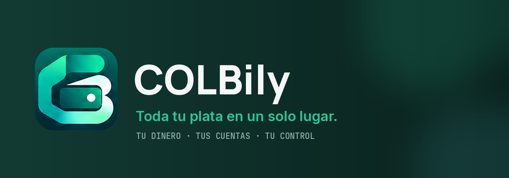
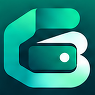
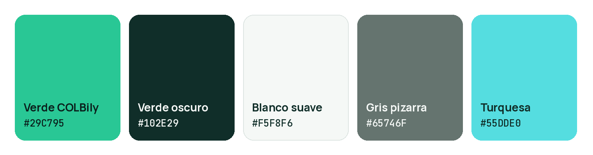
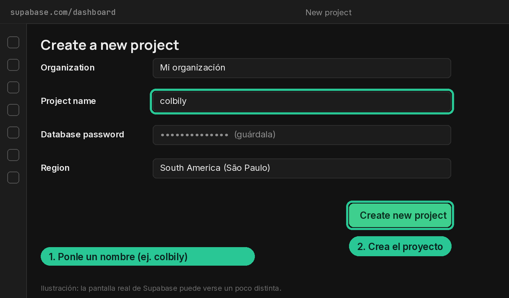
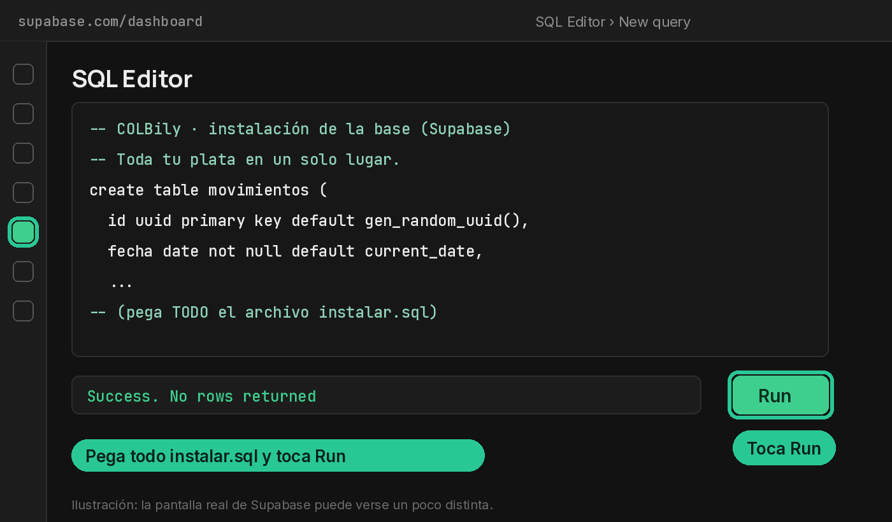
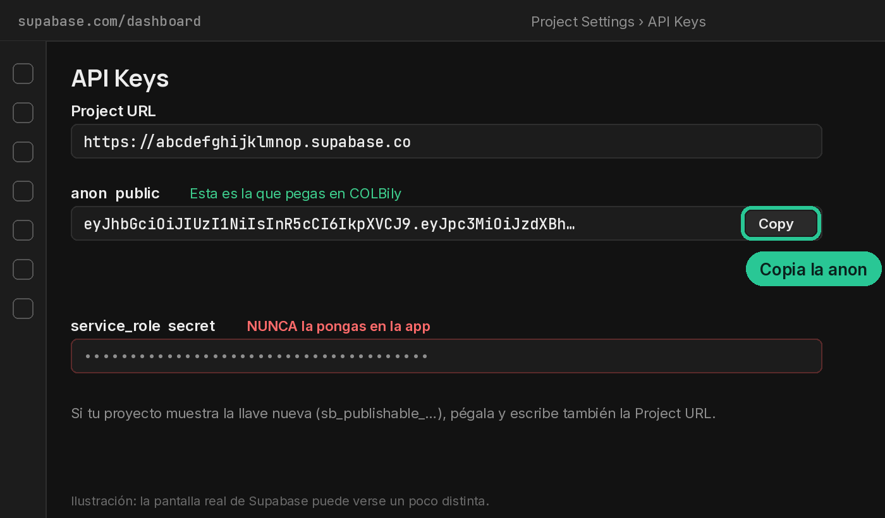
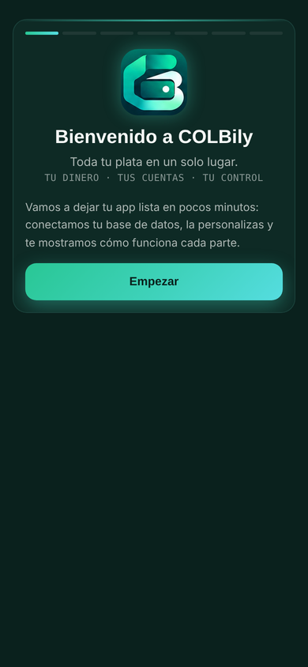
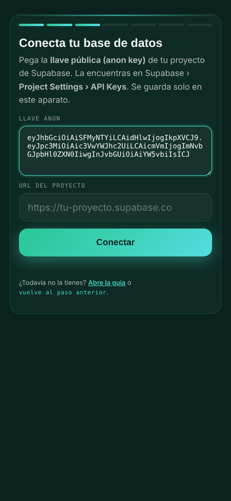
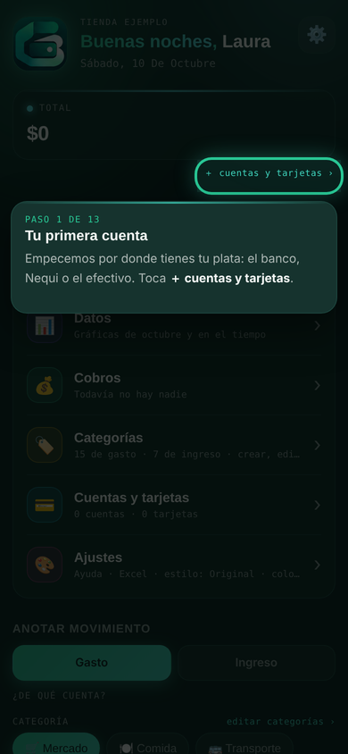

<p align="center">
  
</p>

# COLBily

**Toda tu plata en un solo lugar.**
*Tu dinero. Tus cuentas. Tu control.*

COLBily es una app web para organizar tus finanzas personales: cuentas y billeteras
(también en efectivo, billete por billete), bolsillos, tarjetas de crédito con sus
cortes y cuotas, gastos e ingresos por categoría, cobros y deudas de cada mes, gráficas
y descarga en Excel. Cada persona guarda sus datos en **su propia base de datos de
Supabase** (gratis) y la app se conecta con una sola llave.

---

## Contenido

1. [Identidad de la marca](#1-identidad-de-la-marca)
2. [Instalación: crear tu base de datos y conectarla](#2-instalación-crear-tu-base-de-datos-y-conectarla)
3. [El primer uso: la configuración y el tutorial](#3-el-primer-uso-la-configuración-y-el-tutorial)
4. [Publicar la app en Cloudflare](#4-publicar-la-app-en-cloudflare)
5. [COLBily Business](#5-colbily-business)
6. [Seguridad y privacidad](#6-seguridad-y-privacidad)
7. [Qué hay en esta carpeta](#7-qué-hay-en-esta-carpeta)
8. [Preguntas frecuentes](#8-preguntas-frecuentes)

---

## 1. Identidad de la marca

### Identidad principal

| | |
|---|---|
| **Nombre oficial** | COLBily |
| **Eslogan** | Toda tu plata en un solo lugar. |
| **Mensaje secundario** | Tu dinero. Tus cuentas. Tu control. |
| **Personalidad** | Moderna, amigable, colombiana, confiable y tecnológica. |
| **Público** | Personas que quieren organizar gastos, ingresos, cuentas, tarjetas, deudas y cobros personales. |

**De dónde sale el nombre.** *COL* representa a Colombia y *Bily* es un nombre de marca
inspirado en la palabra *billetera*. Se escribe siempre **COLBily**: COL en mayúsculas,
B mayúscula, *ily* en minúsculas, sin espacios.

### Logo

<p>
  <picture>
    <source media="(prefers-color-scheme: dark)" srcset="docs/img/logo-fondo-oscuro.png">
    
  </picture>
  &nbsp;&nbsp;
  
</p>

| Recurso | Archivo | Uso |
|---|---|---|
| Isotipo (C + B con la billetera) | `docs/img/isotipo.png` | Sobre fondos claros, sin texto |
| Logo horizontal | `docs/img/logo-horizontal.png` | Documentos, web, fondos claros |
| Versión para fondos oscuros | `docs/img/logo-fondo-oscuro.png` | Fondos oscuros |
| Ícono de la app (iOS / Android) | `icons/icon-512.png`, `icons/icon-192.png`, `icons/apple-touch-icon.png` | Pantalla de inicio del celular |
| Favicon | `icons/favicon.ico`, `icons/favicon-32.png`, `icons/favicon-16.png` | Pestaña del navegador |

> El logo no se deforma, no se recolorea con colores fuera de la marca y siempre lleva
> aire alrededor (como mínimo, la altura de la letra *C* del isotipo).

### Colores de marca



| Color | Hex | Para qué |
|---|---|---|
| **Verde COLBily** | `#29C795` | El color principal: botones, acentos, lo que se escoge |
| **Verde oscuro** | `#102E29` | Fondos y tarjetas de la identidad, texto sobre verde |
| **Blanco suave** | `#F5F8F6` | Texto sobre fondos oscuros, fondos claros |
| **Gris pizarra** | `#65746F` | Textos secundarios, bordes, notas |
| **Turquesa** | `#55DDE0` | Segundo acento: degradados, gráficas, detalles |

Estos colores son **exclusivos de la identidad corporativa predeterminada** y de ciertos
elementos de marca (logo, ícono, pantalla de bienvenida, la paleta **★ COLBily**, que es la
que viene puesta). **No sustituyen** las 20 paletas que cada persona puede escoger en
*Ajustes › Colores*: esas siguen iguales.

### Tipografía

| Para | Letra | Pesos |
|---|---|---|
| Títulos y cifras | **Manrope** (alternativa: Plus Jakarta Sans) | 600 · 700 · 800 |
| Textos | **Inter** | 400 · 500 · 600 |
| Datos técnicos y etiquetas pequeñas | JetBrains Mono | 400 · 500 |

Algunos estilos de la interfaz (*Ajustes › Estilo de la interfaz*) usan su propia letra; el
estilo **Original** usa las de la marca.

### Tono de comunicación

Español colombiano natural, pero profesional. Frases cortas, claras y en positivo. Se
tutea. Pocos emojis, y ninguno en los mensajes importantes (errores, plata, seguridad).

| ✅ Así | ❌ Así no |
|---|---|
| «Tu plata, de un vistazo.» | «¡¡Mira tu billete parcero!! 🤑🤑» |
| «Registra tu movimiento.» | «Ingrese la transacción.» |
| «Tus cuentas están al día.» | «Operación exitosa.» |
| «Movimiento guardado correctamente.» | «¡Listo, pana! 🎉🎉» |
| «No encontramos movimientos para este período.» | «Error 404: sin resultados.» |
| «No pudimos guardar los cambios. Inténtalo de nuevo.» | «Falló todo 😵.» |

---

## 2. Instalación: crear tu base de datos y conectarla

Lo vas a hacer **una sola vez** y toma unos 10 minutos. Necesitas:

- 📧 Un correo para crear tu cuenta en [supabase.com](https://supabase.com) (es gratis).
- 📄 El archivo **`sql/instalar.sql`** de esta carpeta.
- 📱 La app abierta en tu celular o computador.

### Paso 1 · Crea un proyecto nuevo en Supabase

1. Entra a [supabase.com](https://supabase.com), toca **Start your project** y crea tu cuenta.
2. Toca **New project**.
3. Ponle un nombre (por ejemplo `colbily`), escribe una contraseña para la base de datos
   (guárdala en un lugar seguro, aunque COLBily no la pide) y escoge la región más cercana
   (por ejemplo *South America (São Paulo)*).
4. Toca **Create new project** y espera uno o dos minutos mientras se crea.



### Paso 2 · Pega el SQL de instalación y toca Run

1. Consigue el SQL, de cualquiera de estas formas:
   - **Desde GitHub:** abre [`sql/instalar.sql`](sql/instalar.sql), toca el botón **Copy raw file**
     (📋, arriba a la derecha del archivo) o **Download raw file** (⬇).
   - **Desde la app:** en la pantalla *Primero, lee la guía* toca **📋 Copiar el SQL de instalación**
     o **⬇ Descargar instalar.sql**.
   - **Desde esta carpeta:** abre `sql/instalar.sql` con el Bloc de notas y copia todo (Ctrl + A, Ctrl + C).
2. En tu proyecto de Supabase abre **SQL Editor** (el ícono de la barra izquierda) y toca **New query**.
3. Pega **todo** el contenido (Ctrl + V) y toca **Run** (o Ctrl + Enter).
4. Abajo debe salir **`Success. No rows returned`**. Listo: tu base ya tiene todas las tablas,
   funciones, categorías iniciales y permisos de COLBily.



> ⚠️ Pégalo en un **proyecto nuevo y vacío**. Si lo corres otra vez en una base que ya
> tiene COLBily, falla al principio (*relation "movimientos" already exists*) y no cambia
> nada: tus datos quedan iguales.

### Paso 3 · Copia la llave pública (anon key)

1. En tu proyecto ve a **Project Settings** (⚙️ abajo a la izquierda) › **API Keys**.
2. Busca la llave **`anon` `public`** y toca **Copy**. Es un texto largo que empieza por `eyJ…`.
   - Si tu proyecto te muestra primero las llaves nuevas (**Publishable key**, `sb_publishable_…`),
     abre la pestaña **Legacy API keys** para ver la `anon`. También puedes usar la
     *Publishable key*: en ese caso la app te pide además la **Project URL**
     (*Project Settings › Data API*, o el botón **Connect** arriba del proyecto).
3. **Nunca** copies la `service_role` / *secret key*: esa da control total de la base y no
   va en ninguna app. Si la pegas por error, COLBily la rechaza.



> Las imágenes de Supabase son ilustraciones: los nombres de los botones son los reales,
> pero la pantalla puede verse un poco distinta.

### Paso 4 · Pega la llave en la app

1. Abre tu COLBily. La primera vez sale la **bienvenida** → **Empezar** → **Ya tengo mi llave**.
2. Pega la llave en **Llave anon**. La app reconoce sola tu proyecto (muestra
   *Tu proyecto: https://…supabase.co*).
3. Toca **Conectar**.
   - ✅ *¡Conectado!* → sigue la configuración.
   - 🟡 *Tu base está vacía* → te faltó el paso 2: toca **📋 Copiar SQL**, pégalo en el
     SQL Editor, toca **Run** y vuelve a tocar **Conectar**.
   - 🔴 *Esa llave no funciona* → copia otra vez la `anon` de ese mismo proyecto.

<p>
  
  
  
</p>

La llave queda guardada **solo en ese aparato**. En otro celular o computador abres la app
y pegas la misma llave: ves los mismos datos. Para quitarla: *Ajustes › Tu base de datos ›
Desconectar esta base de este aparato*.

---

## 3. El primer uso: la configuración y el tutorial

Después de conectar, la app te lleva de la mano:

| # | Paso | ¿Se puede omitir? |
|---|---|---|
| 1 | **¿Cómo quieres que te llamemos?** (el nombre del saludo) | No |
| 2 | **Tu app:** *COLBily personal* o *Business app* (con código, ver la sección 5) | No |
| 3 | **Tus colores:** la paleta ★ COLBily o cualquiera de las otras 20 | No (puedes dejar la de COLBily) |
| 4 | **Estilo de la interfaz:** el Original o cualquiera de los 20 estilos | No (puedes dejar el Original) |

Luego empieza el **recorrido guiado**: la pantalla se oscurece y solo queda visible lo que
tienes que tocar, con una tarjeta que explica qué hacer. No puedes tocar nada más hasta
terminar el paso. Los pasos que no son indispensables tienen un botón grande
**Omitir este paso** (*lo puedes hacer después cuando quieras*).

| # | Paso del recorrido | ¿Se puede omitir? |
|---|---|---|
| 1 | Crear tu **primera cuenta** (banco, Nequi o efectivo) | **No** |
| 2 | **Dividir la plata en bolsillos** | Sí |
| 3 | Agregar una **tarjeta de crédito** (día de corte, cortes y cuotas) | Sí |
| 4 | **Registrar tu primer movimiento** | No |
| 5 | **Ver tus movimientos** del mes | No |
| 6 | **Buscar el movimiento** que acabas de crear | No |
| 7 | Ver tus **datos y gráficas** | No |
| 8 | Agregar un **cobro** (alguien que te paga cada mes, o una deuda) | Sí |
| 9 | Crear una **categoría** | Sí |
| 10 | **Ajustar tu plata** (*Cuadrar saldos*): cómo dejar los saldos iguales a la realidad | No |
| 11 | **Cómo funciona una cuenta en efectivo:** billetes, vueltas, monedas y traslados | No |
| 12 | **Descargar tu Excel** | No (se explica; se desbloquea después) |

**El Excel se desbloquea con el tiempo.** Para que traiga datos que de verdad sirvan, la
descarga en Excel se habilita cuando llevas **30 movimientos y 14 días** desde el primero.
Mientras tanto, *Ajustes* muestra cuánto te falta, y el día que se cumple la app te guía
para descargar tu primer Excel (una sola vez).

El avance se guarda en tu base: si cierras la app a mitad del recorrido, sigue donde
ibas. Para verlo otra vez: *Ajustes › Tu base de datos › Ver el tutorial otra vez* (ahí
puedes salir cuando quieras).

---

## 4. Publicar la app en Cloudflare

COLBily es una página estática: no necesita servidor propio. Hay tres formas; escoge una.

### Opción A · Subir la carpeta (Cloudflare Pages)

1. Entra a [dash.cloudflare.com](https://dash.cloudflare.com) › **Workers & Pages** › **Create** ›
   pestaña **Pages** › **Upload assets** (*Use direct upload*).
2. Ponle nombre al proyecto (por ejemplo `colbily`) y toca **Create project**.
3. Arrastra la carpeta **`cloudflare/sitio`** completa y toca **Deploy site**.
4. Tu app queda en `https://colbily.pages.dev` (o el nombre que escogiste).

Para actualizarla: *Create deployment* y vuelves a arrastrar la carpeta.

### Opción B · Un solo archivo (Cloudflare Worker)

1. **Workers & Pages** › **Create** › **Worker** (*Start with Hello World*) › ponle nombre › **Deploy**.
2. Toca **Edit code**, borra todo lo que trae, abre **`cloudflare/worker.js`**, copia **todo**
   y pégalo. Toca **Deploy**.
3. Tu app queda en `https://<nombre>.<tu-subdominio>.workers.dev`.

`worker.js` trae la app completa adentro (página, Excel, emojis, íconos y el SQL de
instalación). Pesa ~1,1 MB (≈ 470 KB comprimido), dentro del límite del plan gratis.

### Opción C · Conectada al repositorio de GitHub

**Workers & Pages** › **Create** › **Pages** › **Connect to Git** › escoge el repositorio
`COLBily`. *Build command*: vacío. *Build output directory*: `/`. Cada `git push` publica solo.

### Si cambias algo de la app

- Edita `index.html` (o `excel.js`) en la raíz de esta carpeta.
- Corre `python herramientas/empacar.py`: vuelve a armar `cloudflare/sitio` y `cloudflare/worker.js`.
- Si el repositorio queda con otro nombre o usuario, cambia `README_URL` al principio del
  `<script>` de `index.html` (es el enlace del botón *Abrir la guía*).

### Instalarla en el celular

- **iPhone:** abre el enlace en **Safari** › **Compartir** › **Añadir a pantalla de inicio**.
- **Android:** abre el enlace en **Chrome** › menú ⋮ › **Instalar app** (o *Añadir a pantalla principal*).

---

## 5. COLBily Business

| | COLBily personal | Business app |
|---|---|---|
| Nombre de la app | **COLBily** (no se cambia) | El que la empresa quiera |
| Logo | El de COLBily (no se cambia) | El que la empresa suba |
| Nombre del saludo | Lo escoge cada persona | Lo escoge cada persona |
| Colores y estilo | Las 21 paletas y los 21 estilos | Igual |
| Todas las funciones | ✅ | ✅ |

Para activarla hace falta el **código de activación Business** que entrega COLBily. Se
escribe en el paso *Tu app* del primer uso (opción **Business app**) o después en
*Ajustes › COLBily Business › Activar*. Con Business activo aparecen en *Ajustes* las
secciones **Logo** y **Nombre de la app**, como en la app original. *Volver a COLBily
personal* devuelve la marca COLBily y deja guardados el nombre y el logo de la empresa.

> El código no está escrito en la app: solo su huella (SHA-256), así que no se puede leer
> mirando el código de la página.

---

## 6. Seguridad y privacidad

- **Tus datos son tuyos.** Viven en tu proyecto de Supabase; COLBily no tiene servidor ni
  guarda copias. El Excel se arma en tu aparato y queda solo en tus descargas.
- **La llave anon da acceso a tu base.** Guárdala como una contraseña: no la publiques ni la
  compartas. Si crees que alguien la tiene, en Supabase puedes generar llaves nuevas
  (*Project Settings › API Keys*) y pegar la nueva en la app.
- **Nunca uses la `service_role` / secret key** en la app ni la compartas.
- **Borrar nunca daña tus movimientos.** Cuentas, tarjetas, bolsillos, categorías y listas
  de cobros van a una papelera y se recuperan; los movimientos quedan iguales.
- En el plan gratis de Supabase un proyecto puede pausarse si no se usa en varios días;
  se reactiva desde el panel de Supabase con **Restore**.

---

## 7. Qué hay en esta carpeta

```
COLBily/
├── index.html              # la app completa (un solo archivo)
├── excel.js                # arma el Excel de "Descargar en Excel" (se baja solo al pedirlo)
├── emojis.json             # todos los emojis con nombres en español (se baja solo al pedirlo)
├── manifest.webmanifest    # para instalarla como app en Android
├── icons/                  # ícono de la app y favicons
├── sql/
│   └── instalar.sql        # crea la base de COLBily en un proyecto nuevo de Supabase
├── cloudflare/
│   ├── sitio/              # carpeta lista para subir a Cloudflare Pages (opción A)
│   ├── sitio.zip           # lo mismo en un .zip (Pages también lo acepta)
│   └── worker.js           # la app en un solo archivo para un Worker (opción B)
├── herramientas/
│   └── empacar.py          # vuelve a armar cloudflare/ después de cambiar la app
└── docs/img/               # logos, colores e imágenes de esta guía
```

---

## 8. Preguntas frecuentes

**¿Cuánto cuesta?** Supabase y Cloudflare tienen planes gratis que alcanzan de sobra
para uso personal.

**¿Puedo usar la misma base en el celular y en el computador?** Sí: pega la misma llave
en los dos.

**¿Puedo compartir mi app con mi familia?** Cada persona debería tener su propio proyecto
de Supabase y su propia llave. Si comparten la llave, comparten los mismos datos.

**Corrí el SQL y salió un error.** Revisa que el proyecto sea nuevo y que hayas pegado
**todo** el archivo (empieza con `-- COLBily · instalación de la base` y termina con los
`grant`). Si el proyecto ya tenía tablas, crea uno nuevo.

**La app dice "Tu base está vacía".** La llave es correcta pero falta el paso 2.

**Cambié de celular.** Abre tu enlace de COLBily y pega otra vez tu llave anon: todo sigue ahí.

---

<p align="center"><sub>COLBily · Toda tu plata en un solo lugar.</sub></p>
